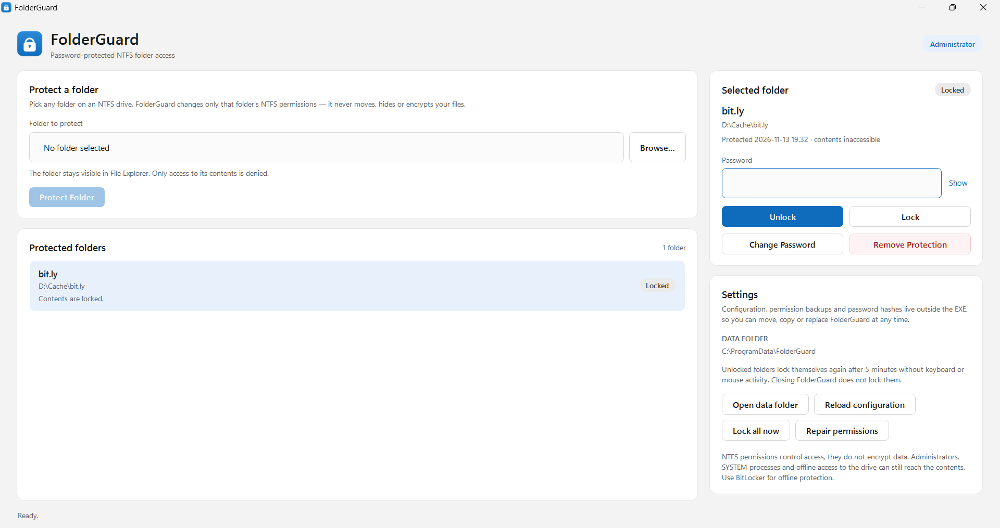

# FolderGuard

**Password-controlled folder access for Windows 10 and Windows 11.**

FolderGuard is a Windows desktop application that lets you protect selected folders with individual passwords. It uses Windows access-control permissions (ACLs) to restrict access to a folder's contents while keeping the folder visible in File Explorer.

FolderGuard does **not** move, hide, rename, or encrypt your files. It changes the selected folder's Windows security permissions.

> **Project status:** AI-assisted personal project, currently in early public-release/pre-release development. I'm progressively learning, reviewing, testing, and maintaining the codebase.

## Screenshot



*The screenshot shows the FolderGuard dashboard with a selected folder in the Locked state, password controls, protected-folder list, and settings panel.*

## Features

- Protect selected folders with individual passwords.
- Keep protected folder names visible in File Explorer while restricting access to their contents.
- Unlock and lock a selected folder from the desktop interface.
- Change a folder's password or remove its protection.
- Manage multiple protected folders independently.
- Lock unlocked folders after five minutes of system-wide keyboard/mouse inactivity.
- Re-lock folders when the Windows logon session ends; the unlock permission is tied to that session.
- Back up and restore folder permissions during protection and removal operations.
- Store application configuration outside the executable, under `%ProgramData%\FolderGuard`.
- Run as a self-contained Windows executable without requiring a separate .NET installation.

## Technology

| Technology | Purpose |
|---|---|
| C# | Application logic |
| .NET 8 | Application framework |
| WPF | Windows desktop interface |
| XAML | Interface layout and styling |
| Windows ACLs / DACLs | Folder access control |
| PBKDF2-HMAC-SHA256 | Password hashing |
| Windows DPAPI | Protecting stored configuration |
| PowerShell / .NET CLI | Development and build workflow |

## Download

Download the Windows build from **[FolderGuard Releases](https://github.com/vigneshh373/FolderGuard/releases)**.

The `win-x64` release is intended for 64-bit Windows. The self-contained build includes the .NET runtime components it needs, so a separate .NET installation should not be required.

## Requirements

- Windows 10 version 1809 or later, or Windows 11.
- An account that is a member of the local Administrators group; Windows displays a UAC elevation prompt.
- A supported NTFS or ReFS volume for the folder being protected.
- The published self-contained executable does not require a separate .NET runtime.

The source project targets .NET 8 and uses WPF. Building it requires the .NET 8 SDK on Windows. The project may also be restorable/buildable on other systems when Windows targeting is enabled, but the Windows application itself must be run and tested on Windows.

## Getting started

1. Download the ZIP from [GitHub Releases](https://github.com/vigneshh373/FolderGuard/releases).
2. Extract the ZIP to a folder of your choice.
3. Run `FolderGuard.exe`.
4. Approve the Windows administrator permission prompt.
5. Use **Browse...** to select a folder on a supported volume.
6. Choose **Protect Folder**, review the confirmation, and set a password.
7. Select the protected folder, enter its password, and choose **Unlock** when you need access.
8. Choose **Lock** to lock it again, or **Remove Protection** to restore the folder's saved original permissions.

**Start with a disposable test folder containing non-important files.** Do not use your only copy of important data while learning how the application works.

## How it works

### Folder permissions

FolderGuard uses Windows discretionary access control lists (DACLs). The application changes the security descriptor on the selected folder. Child files and folders normally receive the effective permissions through ACL inheritance.

The intended states are:

- **Locked:** the normal interactive user does not have the data-access permissions needed to open the folder's contents.
- **Unlocked:** the current Windows logon session receives the permissions needed to use the folder.
- **Removed protection:** the original permission information captured when protection was added is restored.

The folder itself remains visible in its parent directory because its parent directory's permissions are not changed.

### Session-bound unlocking

The implementation uses the current Windows logon-session SID for the temporary unlock grant. The intended effect is that an unlock does not carry over to a different logon session. When the session ends, the session-specific access grant is no longer usable.

The application also includes startup recovery logic to reconcile saved records and folder permissions. This design and its edge cases should be validated on the Windows versions and account configurations the project intends to support.

### Protect workflow

The documented implementation is designed to:

1. Validate the selected folder path and volume.
2. Ask the user to confirm the exact folder.
3. Collect and validate a password.
4. Capture the folder's existing permission information for recovery.
5. Generate a random salt and derive a password hash using PBKDF2-HMAC-SHA256.
6. Record an operation journal entry before changing permissions.
7. Apply the locked permissions and verify the resulting security descriptor.
8. Save the protected-folder record.
9. Attempt to restore the captured permissions if the operation fails.

### Unlock, lock, and remove workflows

- **Unlock:** verify the entered password, then apply the access grant for the current logon session.
- **Lock:** apply the locked permission state and verify the result.
- **Change password:** verify the existing password and replace the stored salt/hash for the new password.
- **Remove protection:** verify the password and restore the saved original permissions, subject to the application's checks and confirmation flow.

These are descriptions of the codebase's intended implementation. They are not a substitute for testing each operation on a disposable Windows test folder.

## Password and configuration storage

The project documentation describes the following design:

- Passwords are processed using PBKDF2-HMAC-SHA256 with a per-folder salt.
- The stored password verifier consists of a salt and derived hash, not the plaintext password.
- Password verification is designed to use a constant-time comparison.
- Configuration is stored under `%ProgramData%\FolderGuard`, rather than beside the executable.
- The configuration file is protected using Windows DPAPI.
- The application maintains a backup and operation journal to support recovery after interrupted operations.
- Logs are intended to record operational information without recording plaintext passwords.

The exact settings and implementation should be checked in the source code when changing password policy or storage behaviour.

## Data location

The application uses a shared data directory:

```text
%ProgramData%\FolderGuard\
├── config.dat
├── config.dat.bak
├── journal\
└── logs\
```

Do not manually delete or modify this directory while folders are protected. The configuration contains the records and permission backups the application may need to restore the original folder permissions.

Keep a separate backup of important files. FolderGuard is not a backup application.

## Build from source

### Install tools

Install the .NET 8 SDK. Visual Studio with the .NET desktop development workload is one option; Visual Studio Code with the C# tooling is another.

### Restore and build

Run these commands from the repository root:

```powershell
dotnet restore FolderGuard.sln
dotnet build FolderGuard.sln -c Release
```

### Publish a self-contained Windows x64 executable

```powershell
dotnet publish FolderGuard\FolderGuard.csproj -c Release -r win-x64 --self-contained true `
  -p:PublishSingleFile=true -p:IncludeNativeLibrariesForSelfExtract=true `
  -p:EnableCompressionInSingleFile=true -o publish\win-x64
```

The output is written to `publish\win-x64`. This output directory is a local build artifact and is not committed to the source repository. Downloadable binaries are distributed through GitHub Releases.

For an ARM64 Windows build, use the `win-arm64` runtime identifier and test it on compatible hardware before publishing it.

## Project structure

```text
FolderGuard.sln
FolderGuard/
├── App.xaml / App.xaml.cs
├── MainWindow.xaml / MainWindow.xaml.cs
├── FolderGuard.csproj
├── app.manifest
├── appsettings.json
├── Models/
├── Services/
│   ├── AclManager.cs
│   ├── PasswordService.cs
│   ├── ConfigurationService.cs
│   ├── FolderProtectionService.cs
│   ├── RecoveryService.cs
│   ├── JournalStore.cs
│   ├── Logger.cs
│   ├── AppOptions.cs
│   └── OperationResult.cs
├── ViewModels/
├── Views/
└── Resources/
tools/
└── make_icon.py
screenshots/
└── folderguard-dashboard.png
README.md
```

The exact contents may evolve as the project is maintained. Refer to the repository's current folders and files for the authoritative structure.


## Security limitations

**FolderGuard changes access permissions; it does not encrypt files.**

- NTFS/ReFS permissions are not a substitute for encryption. Someone with sufficient administrative control or offline access to the disk may be able to change permissions or read the data.
- The password protects FolderGuard's unlock workflow; it is not used as an encryption key for the folder contents.
- DPAPI protection of the configuration file does not encrypt the protected folder's files.
- Explicit permissions on individual child files or folders may affect the effective access result. Test folders with unusual or custom permission layouts carefully.
- A local administrator with sufficient privileges may be able to take ownership or modify permissions.
- The application requires elevated permissions to manage folder security descriptors.
- Do not rely on FolderGuard as the only protection for sensitive information. Use an appropriate full-disk or file-encryption solution where confidentiality is required.

FolderGuard is an early-stage utility, not a professionally audited security product. Do not treat it as a security boundary against a determined local administrator or someone with physical access to the storage device.

## Recovery and troubleshooting

- **Access is still denied after unlocking:** check that the correct folder is selected and that the application reports it as Unlocked. Close and reopen File Explorer to rule out a stale window or cached handle.
- **The folder reports a protection error:** do not delete the application's data directory. Review the application message and logs before attempting recovery.
- **The configuration file is missing or damaged:** do not create a replacement by hand. The application may need its backup configuration to identify the original permissions.
- **You forgot a folder password:** the password hash is not reversible. Follow the application's documented recovery path carefully; do not experiment on important folders.
- **The folder is on an unsupported file system:** use a supported NTFS or ReFS volume.
- **The app cannot change permissions:** confirm that it was started with the required administrator approval.

If a folder contains important data and its access state is unexpected, stop experimenting and make sure you have a separate backup before attempting permission recovery.

## Contributing and development

FolderGuard began as an idea translated into an application with AI assistance. The project is now being used as a learning exercise in understanding, testing, documenting, and maintaining a real codebase.

Useful contributions include:

- Reproducible bug reports with Windows version and steps.
- Documentation corrections.
- UI and accessibility improvements.
- Automated tests for non-destructive logic.
- Review of error handling and recovery behaviour.

Please do not submit changes that claim security guarantees without reproducible tests.

## License

No license has been selected yet. Until a license is added, the repository is publicly viewable, but reuse and redistribution are not automatically granted.